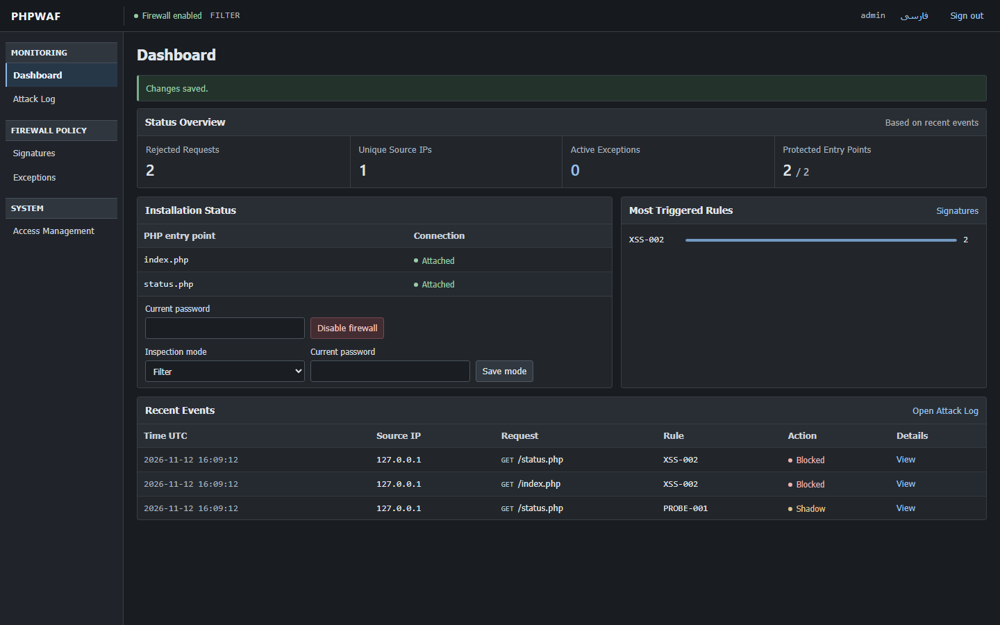
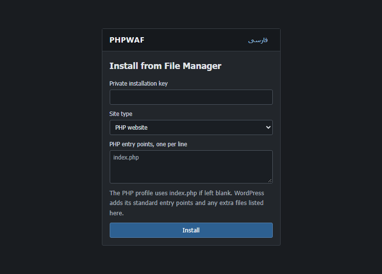
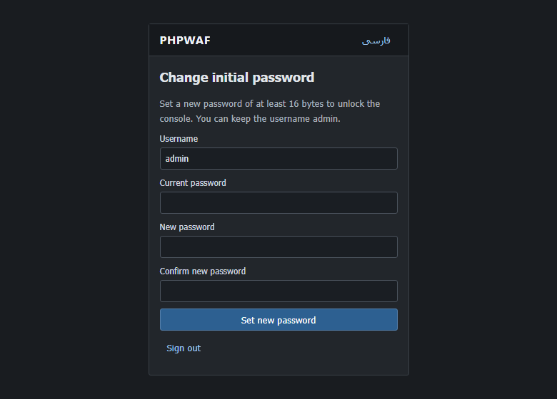
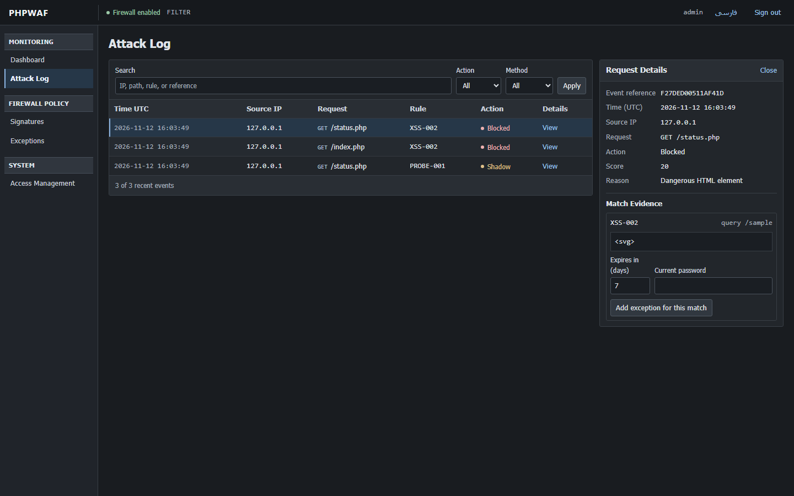

# نصب و فعال‌سازی PHPWAF

[راهنمای کامل انگلیسی و امکانات پنل](README.md)

پوشهٔ <code>waf</code> را بیرون ریشهٔ وب، مثلاً کنار <code>public_html</code>، قرار بده. حساب PHP باید به فایل‌های بسته دسترسی خواندن و به پوشهٔ خصوصی، فایل‌های ورودی انتخاب‌شده و پوشه‌های والدشان دسترسی نوشتن داشته باشد.

## هاست PHP با ترمینال

مسیرهای نمونه را با مسیرهای هاست خودت جایگزین کن.

~~~bash
php /home/ACCOUNT/waf/admin/setup.php \
  --root=/home/ACCOUNT/public_html \
  --state=/home/ACCOUNT/waf-private \
  --entry=index.php
~~~

برای هر اسکریپت PHP دیگری که مستقیماً درخواست می‌گیرد، یک <code>--entry</code> اضافه کن. کد راه‌اندازی چاپ‌شده را نگه دار.

## وردپرس

<code>--root</code> را روی پوشهٔ وردپرس بگذار. برای انتخاب دستی، ورودی‌های وردپرس را به دستور اضافه کن.

~~~bash
php /home/ACCOUNT/waf/admin/setup.php \
  --root=/home/ACCOUNT/public_html \
  --state=/home/ACCOUNT/waf-private \
  --entry=index.php --entry=wp-login.php \
  --entry=wp-admin/index.php --entry=wp-admin/post.php \
  --entry=wp-admin/admin-ajax.php --entry=wp-cron.php \
  --entry=xmlrpc.php
~~~

اگر ترمینال نداری، مراحل File Manager را انجام بده و در فرم **WordPress** را انتخاب کن. وضعیت اتصال فایل‌ها را پس از به‌روزرسانی هسته دوباره بررسی کن.

## هاست با File Manager

1. بسته را بیرون <code>public_html</code> باز کن. اسم پوشه باید <code>waf</code> باشد.
2. [سازندهٔ کلید آفلاین](examples/setup-key.html) را از داخل بسته در مرورگر کامپیوتر خودت باز کن. کلید ۴۸ نویسه‌ای را در یک خط داخل <code>phpwaf-setup.key</code>، کنار <code>waf</code>، قرار بده. این فایل خصوصی است.
3. [فایل نصب‌کننده](examples/phpwaf-install.php) را در پوشهٔ عمومی سایت کپی کن. اگر وردپرس در زیرپوشه است، مقدار <code>$private</code> را در همان کپی به مسیر مطلق پوشهٔ خصوصی حسابت تغییر بده.
4. آدرس <code>/phpwaf-install.php</code> را روی دامنه‌ات با HTTPS باز کن. کلید را وارد کن و نوع سایت را انتخاب کن. در صورت نیاز، مسیر نسبی هر فایل PHP اضافی را در یک خط بنویس.
5. روی **Install** بزن و کد ورود اولیه‌ای را که نمایش داده می‌شود ذخیره کن. سپس فایل نصب‌کننده و کلید خصوصی را از File Manager حذف کن.

## اولین ورود و روشن‌کردن فایروال

پنل از مسیر <code>/firewall-admin/index.php</code> باز می‌شود. با <code>admin / admin</code> و کد راه‌اندازی وارد شو و رمز قویِ حداقل ۱۶ بایتی ثبت کن. در **Dashboard → Installation Status** حالت **Monitor** را ذخیره کن، سپس **Enable firewall** را بزن. وضعیت فایل‌ها باید **Attached** شود. بعد از بررسی درخواست‌های عادی می‌توانی حالت **Filter** را فعال کنی.

**Attack Log** درخواست‌ها و شواهد تطبیق را نشان می‌دهد. **Signatures** برای روشن و خاموش‌کردن هر قانون است. **Exceptions** استثناهای زمان‌دار را مدیریت می‌کند و **Access Management** رمز، محدودیت IP و فعالیت مدیر را نشان می‌دهد. از نوار بالای پنل **فارسی** را انتخاب کن.

برای روش اجرای مستقل، تنظیم هدرهای PHP و وب‌سرور و بازیابی حساب مدیر، [راهنمای کامل](README.md) را ببین.
