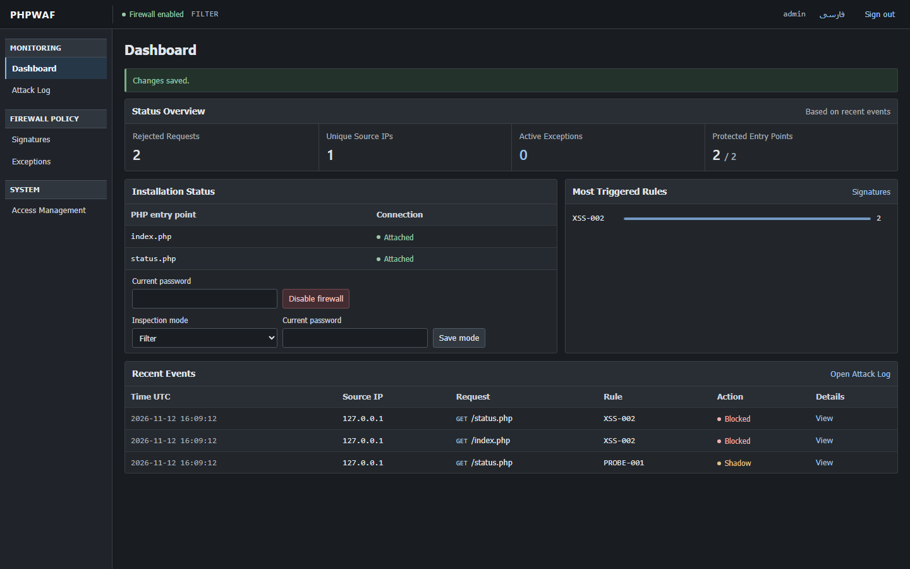
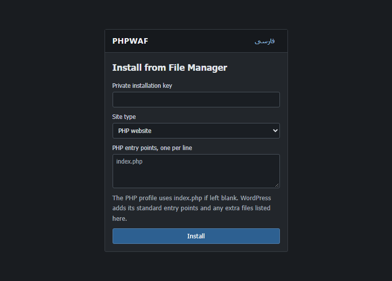
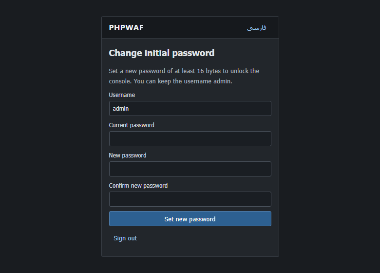
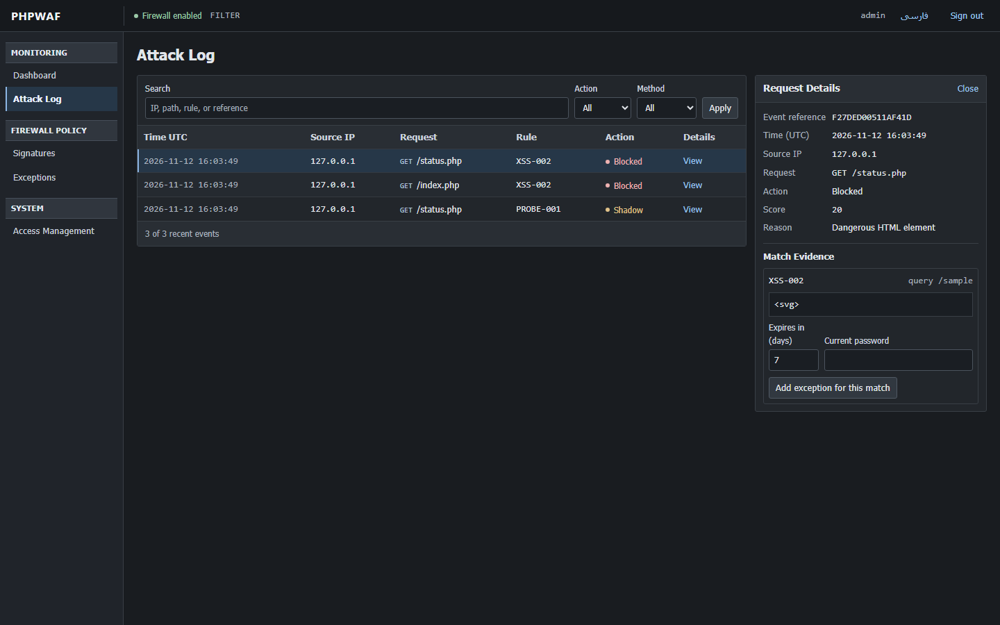
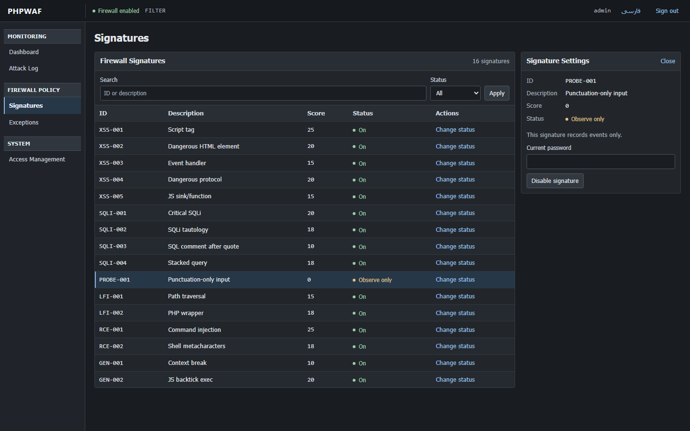

# PHPWAF

PHPWAF inspects requests before they reach a PHP application. Use the browser console to attach the firewall to approved PHP entry points, review security events, tune signatures, and manage scoped exceptions.

[راهنمای فارسی نصب و فعال‌سازی](README.fa.md)

## Choose an installation method

| Hosting setup | Installation | Activation |
| --- | --- | --- |
| PHP hosting with SSH or a hosting terminal | [Install on a PHP host](#install-on-a-php-host) | Dashboard → Enable firewall |
| WordPress | [Install on WordPress](#install-on-wordpress) | Dashboard → Enable firewall |
| Hosting with File Manager and HTTPS | [Install with File Manager only](#install-with-file-manager-only) | Dashboard → Enable firewall |
| Existing server-managed PHP configuration | [Standalone integration](#standalone-integration) | Front controller include or PHP auto-prepend |

### Requirements

- PHP 8.0 or newer with <code>mbstring</code> and <code>json</code>. Redis and APCu are optional.
- Managed installation needs HTTPS in production. PHP's development server can be used on loopback for local tests.
- Keep the package and state outside the document root. The PHP account needs read access to the package and write access to the private state, the selected PHP entry points, and their parent directories.
- Managed activation checks existing includes. Remove any earlier manual PHPWAF include or PHPWAF auto-prepend setting before activating the managed hooks.

## Install on a PHP host

1. Download the source archive and extract it. Name the package folder <code>waf</code> and place it beside the site's public directory.
2. In SSH or the hosting terminal, run the installer under the site's PHP account. Replace the sample paths with your own. Add an <code>--entry</code> argument for each PHP script that serves requests directly.

   ~~~bash
   php /home/ACCOUNT/waf/admin/setup.php \
     --root=/home/ACCOUNT/public_html \
     --state=/home/ACCOUNT/waf-private \
     --entry=index.php
   ~~~

3. Save the first-sign-in setup code printed in the terminal and follow [First sign-in and activation](#first-sign-in-and-activation).

## Install on WordPress

Use the directory containing WordPress's <code>index.php</code> and <code>wp-login.php</code> as the site root. A WordPress site in a subdirectory uses that subdirectory as the site root and still keeps PHPWAF and its state outside the whole public document root.

### With a terminal

List the PHP files you want PHPWAF to cover. This example includes the public front controller, login, editor, AJAX, cron, and XML-RPC entry points.

~~~bash
php /home/ACCOUNT/waf/admin/setup.php \
  --root=/home/ACCOUNT/public_html \
  --state=/home/ACCOUNT/waf-private \
  --entry=index.php \
  --entry=wp-login.php \
  --entry=wp-admin/index.php \
  --entry=wp-admin/post.php \
  --entry=wp-admin/admin-ajax.php \
  --entry=wp-cron.php \
  --entry=xmlrpc.php
~~~

### With File Manager

Follow [Install with File Manager only](#install-with-file-manager-only) and select **WordPress**. The profile selects existing files from the entry list above. Enter any additional publicly callable PHP scripts one per line.

After a WordPress core update, check **Installation Status** for entries whose hooks were replaced. Use **Disable firewall** followed by **Enable firewall** to reattach the approved entries. Review login, editor, form, upload, and checkout activity in Monitor mode before enforcing on a site with plugins.

## Install with File Manager only

Use your hosting account's File Manager to put the files in this layout. The installer creates <code>waf-private</code>.

~~~text
/home/ACCOUNT/
  waf/
    admin/
    examples/
    src/
    guard.php
  phpwaf-setup.key
  public_html/
    index.php
    phpwaf-install.php
~~~

1. Upload and extract the package outside <code>public_html</code>. Name the extracted package folder <code>waf</code>.
2. Open the bundled [offline key generator](examples/setup-key.html) locally after extracting the archive, or generate a random 48-character key in a password manager. Create <code>phpwaf-setup.key</code> beside <code>waf</code> and paste the key on one line. Keep the file outside the document root.
3. Copy [examples/phpwaf-install.php](examples/phpwaf-install.php) into the site's public directory. If your site is in a subfolder such as <code>public_html/blog</code>, edit <code>$private</code> in that copy to your account's absolute private directory, for example <code>/home/ACCOUNT</code>.
4. Open <code>https://your-domain.example/phpwaf-install.php</code> in a browser. For a site in a subdirectory, use the corresponding path. Enter the private installation key and select **PHP website** or **WordPress**.
5. For a PHP site, an empty entry list selects <code>index.php</code>. For WordPress, the installer includes the standard entry points listed above. Enter extra paths relative to the site directory, one per line.
6. Select **Install**. Copy the **first-sign-in setup code** from the result screen. The installation key authorizes the installer, and the setup code authorizes the first panel sign-in.
7. After saving the setup code, remove the public installer and its private key in File Manager. Follow [First sign-in and activation](#first-sign-in-and-activation).

The installer locks itself after successful setup. On hosts where File Manager or PHP cannot access a private directory outside the web root, ask the host for a private path and the required permissions before setting up the managed panel.

## First sign-in and activation

1. Open <code>/firewall-admin/index.php</code> on the site over HTTPS.
2. Sign in with <code>admin / admin</code> and the setup code shown by the installer. On the PHP development server running directly on loopback, the initial sign-in can use the local flow.
3. Set a strong password of 16–72 bytes. The username may remain <code>admin</code>. The console unlocks after the password changes, and the setup code is discarded.
4. On **Dashboard → Installation Status**, choose **Monitor** and save the mode using your current password. Select **Enable firewall** and confirm that the approved files show **Attached**.
5. Test ordinary site workflows and review the attack log. Select **Filter** when you are ready to block matching requests. Select **Enforce** if you also want per-IP state and temporary bans.

**Disable firewall** stops inspection and removes the exact managed blocks from the selected files. Other application edits stay in place. If a host rejects writes or an entry conflicts with a manual include, the dashboard reports the affected files.

English is the default language. Select **فارسی** on the sign-in page or in the console header for Persian.

## Console features

| Section | Controls |
| --- | --- |
| Dashboard | Connected entry points, recent events, common rules, inspection mode, and enable or disable controls |
| Attack Log | Search by IP, path, rule, or reference. Filter by method and action. Inspect the reason and bounded evidence beside the table |
| Signatures | Filter, inspect, and enable or disable built-in rules individually |
| Exceptions | Add an exception from a blocked event and review, expire, or remove it |
| Access Management | Rotate credentials, manage an optional IP/CIDR allowlist, and review administrator activity |

An exception applies to the same rule, method, path, source, field, and exact value. PHPWAF stores a keyed fingerprint of the value and expires the exception after 1–30 days. Recognized sensitive fields and headers are redacted. Keep the private log directory outside the document root.

Per-rule changes, exceptions, mode changes, and access changes require the current password. A rule in shadow mode records evidence without contributing to the blocking score. The <code>PROBE-001</code> punctuation-only rule remains observation-only when enabled.

## Inspection and storage

| Mode | Behavior |
| --- | --- |
| Monitor | Records decisions while requests continue to the application |
| Filter | Rejects individual matching requests without using a per-IP state store |
| Enforce | Adds behavioral scoring and temporary IP bans using the configured store |

PHPWAF inspects query, form, cookie, JSON, and selected request metadata under configurable limits for size, nesting, and field count. Default limits include 128 KiB of JSON, 8 KiB per inspected key or value, and 256 KiB of aggregate inspected input. An exceeded budget returns <code>413</code> in blocking modes. Invalid JSON sent as JSON returns <code>400</code>. File upload contents require validation by the application.

The built-in rules cover common XSS, SQL injection, command injection, and path traversal patterns. Configure disabled and shadow rules, inspection limits, honeypots, proxy trust, and IP allowlists in [config.php](config.php). Monitor legitimate traffic when tuning a site.

In Enforce mode, the storage selector supports Redis, APCu, and a file fallback. JSONL logs include event references, rule IDs, and bounded request metadata. The optional [nginx denylist](examples/nginx.conf) and [fail2ban examples](examples/fail2ban/) can enforce bans upstream. nginx denylist entries remain until pruned and the configuration is reloaded. fail2ban can apply timed bans using its own configuration.

## Standalone integration

Place the package outside the document root and give PHP write access to <code>waf_storage</code>. For a PHP app with a single front controller, insert this before application output and after any leading PHP declarations.

~~~php
require_once __DIR__ . '/../waf/guard.php';
~~~

For server-wide coverage of PHP scripts, set an absolute <code>auto_prepend_file</code> path in the configuration your host uses.

~~~ini
auto_prepend_file = "/home/ACCOUNT/waf/guard.php"
~~~

PHP-FPM hosts may accept this in <code>.user.ini</code>. For Apache with mod_php, use <code>php_value auto_prepend_file "/home/ACCOUNT/waf/guard.php"</code> in the appropriate Apache configuration. Use one integration method for the site. Standalone settings are read from <code>config.php</code>.

## Response privacy

Set <code>expose_php=Off</code>, <code>display_errors=Off</code>, <code>display_startup_errors=Off</code>, and <code>log_errors=On</code> in the active PHP configuration. See the [php.ini example](examples/auto_prepend/php.ini). PHPWAF strips common version and debug headers from PHP responses and returns plain-text block messages with a reference code.

Apply server-header handling at the final HTTP hop. The [Caddy example](examples/Caddyfile) removes the <code>Server</code> header from ordinary responses, redirects, and edge errors. The [nginx example](examples/nginx.conf) hides PHP headers and suppresses nginx version numbers. Apache's <code>ServerTokens Prod</code> and <code>ServerSignature Off</code> suppress server version details. Any metadata generated in application HTML or JSON is controlled by the application.

## Recovery and upgrades

Back up the private state directory. It holds credentials, deployment settings, policy overrides, exceptions, and logs. The terminal installer offers <code>--settings=keep</code> and <code>--settings=reset</code> when reinstalling into existing state.

Use the hosting terminal to recover a lost administrator account. The owner can supply a strong username and password or start a fresh first-sign-in rotation.

~~~bash
php /home/ACCOUNT/waf/admin/setup.php \
  --state=/home/ACCOUNT/waf-private --reset-admin
~~~

For emergency shutdown from the terminal, use <code>--disable</code> with the same state path. To apply changes from <code>config.php</code> to an existing managed installation, use <code>--reload-engine</code>. Inspection mode and signature toggles are available in the console for File Manager installations.

## Tests

~~~text
php tests/run.php
python tests/http_integration.py
python tests/panel_integration.py
python tests/web_install_integration.py
python tests/edge_integration.py PATH_TO_CADDY PATH_TO_OPENSSL
~~~

The integration tests use disposable services on loopback. They cover ordinary PHP, both installer profiles, first-sign-in rotation, mode changes, reversible hooks, privacy headers, scoped exceptions, and final-hop HTTP/TLS responses.

The File Manager WordPress profile was also checked on WordPress 7.1.4 with MariaDB 10.4. The test exercised the public site, login, dashboard, REST reads, and saving a post through the editor API.

## License

[MIT](LICENSE)
